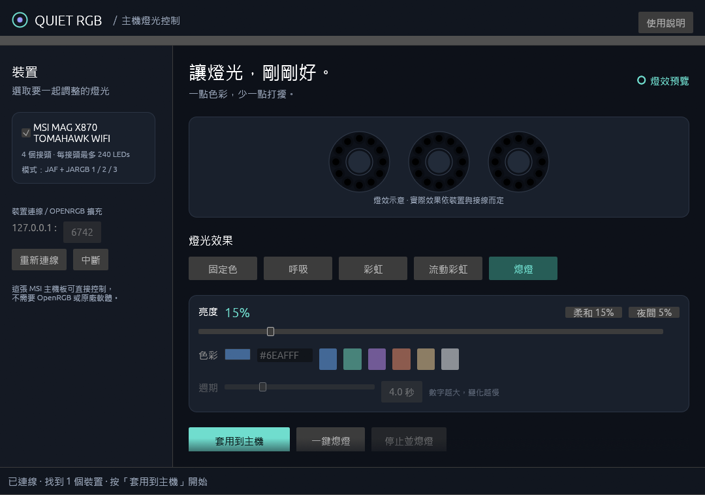

# Quiet RGB

> 原作者：Alan (alanting9999)

用 Rust + egui 製作的 Windows 主機燈光控制器。直接透過 USB HID 控制 **MSI MAG X870 TOMAHAWK WIFI（MS-7E51）** 主機板的 ARGB 接頭，不需要安裝原廠燈控軟體、OpenRGB、PawnIO 驅動，也不需要系統管理員權限。



## 為什麼要做

原廠燈控軟體通常體積大、常駐多個背景服務，有時還需要核心驅動。這個專案只做一件事：把主機燈光調到「剛剛好」——預設 15% 亮度、一鍵熄燈、關閉程式時自動熄燈，執行檔只有一個。

## 功能

- 燈效：固定色、呼吸、彩虹、流動彩虹、熄燈，所有燈效都受亮度上限約束
- 亮度快捷鍵：柔和 15%、夜間 5%
- 「一鍵熄燈」持續輸出全黑；「停止並熄燈」熄燈並停止動畫輸出
- 「關閉程式時熄燈」預設開啟；只影響本程式正在控制的裝置
- 開啟或連線時**不會**自動改燈，按「套用到主機」才開始即時控制
- 設定保存在 eframe 使用者資料目錄，下次啟動仍先進入預覽

## 運作方式

```text
egui 介面 (main.rs)
   │ 使用者設定
   ▼
背景控制執行緒 (worker.rs) ── 每幀計算燈效 (effect.rs)
   │
   ▼
裝置路由 (backend.rs)
   ├─ 原生 USB HID (msi.rs) ── MSI 761-byte 協定 → 主機板 ARGB 接頭
   └─ OpenRGB SDK (openrgb.rs，選用) ── TCP 127.0.0.1:6742 → 其他裝置
```

- **裝置辨識**：以 USB `0DB0:0076`、usage page `FF00`、usage `1` 及序號前綴 `7E51` 判斷，只對已確認的 MS-7E51 生效，不會誤寫其他 MSI 型號。
- **封包格式**：MSI 主機板使用 761 bytes 的 feature report，涵蓋 JAF、JARGB1、JARGB2、JARGB3 四個接頭，每個接頭最多 240 個 LED 色彩槽位（這是協定上限，不代表實際偵測到 960 顆 LED）。協定實作參考 OpenRGB 的 `MSIMotherboard761Controller`，詳見 [THIRD_PARTY.md](THIRD_PARTY.md)。
- **非阻塞**：USB 與 SDK 都在背景執行緒運作，連線錯誤不會卡住 UI；任一後端出錯時停止整個工作階段，並提示實際燈光可能停在最後狀態。

### 為什麼不直接用 OpenRGB？

這台電腦上的 OpenRGB 1.0 偵測不到主機板：Windows 回報的 DMI 名稱是 `MS-7E51`，但 OpenRGB 的主機板表比對的是完整商品名稱。Quiet RGB 改以 USB 裝置資訊辨識，因此不需要修改 OpenRGB。

## 支援的硬體

| 裝置 | 狀態 |
| --- | --- |
| MSI MAG X870 TOMAHAWK WIFI（MS-7E51）主機板 ARGB | ✅ 已實機驗證（低亮度藍色、熄燈） |
| 其他 OpenRGB 支援裝置（Direct／Custom／Static 模式） | 選用，需先開啟 [OpenRGB](https://openrgb.org/releases.html) 的 SDK Server |
| 顯示卡 RGB | 尚未驗證 |

鍵盤、滑鼠在 OpenRGB 模式下預設不勾選。

## 安全說明

- 只寫入燈光色彩，**不**調整風扇轉速、不更新韌體、不修改 BIOS／DMI。
- 請避免另一個燈控程式同時寫入主機板。
- 正常關閉才會執行熄燈收尾；強制終止、USB 拔除或斷電時，裝置可能保留最後狀態。
- 呼吸和彩虹由程式逐幀產生，需保持程式執行。

## 建置

需要 Rust 1.95+、Visual Studio C++ Build Tools 與 Windows SDK。

```powershell
cargo run                                            # 開發執行
cargo test --locked                                  # 單元測試
cargo clippy --locked --all-targets -- -D warnings   # 靜態檢查
.\scripts\Build.ps1                                  # 格式、clippy、測試、release 打包到 dist\QuietRGB.exe
.\Start-QuietRGB.ps1                                 # 啟動已打包的程式
```

硬體檢查工具：

```powershell
cargo run --example probe_msi          # 唯讀列出偵測到的主機板
cargo run --example probe_msi -- --off # 實機送出熄燈
```

測試涵蓋亮度上限、呼吸極值、彩虹空間分布、MSI 封包接頭／RGB 排列／界限、OpenRGB 截斷封包處理，以及本機模擬伺服器通訊。

## 原始碼結構

| 檔案 | 職責 |
| --- | --- |
| `src/main.rs` | egui 介面 |
| `src/effect.rs` | 燈效計算 |
| `src/msi.rs` | MSI 原生 USB HID 後端 |
| `src/openrgb.rs` | OpenRGB SDK 用戶端 |
| `src/backend.rs` | 裝置路由 |
| `src/worker.rs` | 背景控制執行緒 |

## 授權與致謝

GPL-2.0-or-later，見 [LICENSE](LICENSE)。MSI 761-byte 協定改寫自 OpenRGB（rom4ster, 2025；GPL-2.0-or-later），上游實作另致謝 SignalRGB；相依套件授權見 [THIRD_PARTY.md](THIRD_PARTY.md)。
